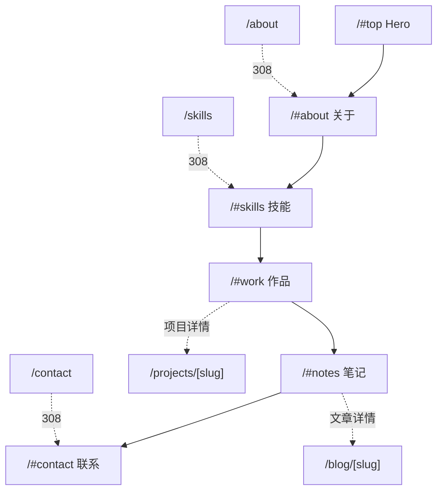

# Improve.md — 个人站点精修规格（v1.0）

> 本文件是下一轮「精修打磨」的施工图，不替代 [`PRD.md`](PRD.md)、[`PRD2.md`](PRD2.md)、[`TECH_DESIGN.md`](TECH_DESIGN.md)，也不改动 [`AGENTS.md`](AGENTS.md) 的工程约定。实现时以本文件 + 现有代码为准。
>
> 阅读顺序建议：§1 现状 → §2 决策 → §3 结构 → §4 视觉 → §5–§10 分区 → §11 素材 → §13 阶段 → §14 验收。

---

## 1. 现状盘点

### 1.1 技术底座（以仓库实际为准）

| 项 | 现状 | 位置 |
|---|---|---|
| 框架 | Next.js `^16.4.3` App Router + React `^19.3.1` + TypeScript `^6.0.3` | [`package.json`](package.json) |
| 样式 | Tailwind v4（`@import 'tailwindcss'`）+ 手写 `globals.css`（约 1500 行，类名驱动） | [`app/globals.css`](app/globals.css) |
| 字体 | `Inter`（`--font-sans`）+ `Newsreader`（`--font-display`），`next/font/google` | [`app/layout.tsx`](app/layout.tsx) |
| 内容层 | 纯 TS 常量：`projects / posts / skills / profile`，无 MDX 文件 | [`lib/content`](lib/content) |
| 图片 | `next/image` + `public/images`，**两张人像各约 4 MB** | [`public/images`](public/images) |
| 视频 | 本地 mp4 + 点击才播放（`LocalVideo` + 首帧海报） | [`components/media/LocalVideo.tsx`](components/media/LocalVideo.tsx) |
| 已有动效 | `Reveal` 滚动入场、Hero 级联、顶栏进度条、封面色调漂移、`PageTransition` | [`components/motion`](components/motion)、`app/globals.css` |
| 已有设备框 | `.laptop-frame / .laptop-lid / .laptop-screen`（笔记本外框） | [`components/home/DeviceVideoCarousel.tsx`](components/home/DeviceVideoCarousel.tsx) |
| 眉题横线 | `.section-heading .eyebrow::before` 已在滚动入场时从 0 展开到 24px | `app/globals.css` §眉题 |
| 已有跑马灯 | `.marquee / .marquee-track`（hover 暂停、容器裁剪），当前仅用于项目详情的技术栈条 | `app/globals.css` 末尾、`app/projects/[slug]/page.tsx` |

### 1.2 现有信息架构

```
/            首页（Hero / 关于摘要 / 技能摘要 / 精选项目 / 精选笔记 / 联系 CTA）
/about       关于（导语 + 我做什么 + 时间线 + 教育 + 当前关注）
/skills      技能（4 组：项目成就 / B 站教学 / 机械臂与视觉 / 工程与表达）
/projects    作品列表（类型 + 标签筛选，URL 承载筛选态）
/projects/[slug]  作品详情（目标 / 过程 / 结果 / 图集 / 视频 / 相邻导航）
/blog        笔记列表（分类筛选）
/blog/[slug] 笔记详情
/contact     联系（渠道列表 + 留言表单）
```

问题：首页每个区块都以「完整介绍 →」「全部技能 →」「全部作品 →」「全部笔记 →」把访客推走，首页沦为导航中转站；技能以成就叙事组织，看不到「学过哪些技术」；作品只有一种「左图右文」的行式布局，视频与图文混在一起。

---

## 2. 决策记录（本次精修的三条硬约束）

| 编号 | 决策 | 理由 | 备选与放弃原因 |
|---|---|---|---|
| D1 | **单页主站**：首页承载关于 / 技能 / 作品 / 笔记 / 联系全部内容，主导航改首页锚点；`/about`、`/skills`、`/contact` 下线并重定向；`/projects/[slug]`、`/blog/[slug]` 详情页保留 | 内容量还不足以支撑 6 个独立页面；单页能把「认识 → 证明 → 联系」压进一条连续叙事 | 放弃「保留子页面只删首页跳转链接」：导航仍会把访客分流，首页改版收益被抵消 |
| D2 | **技能轨道用纯 CSS/SVG 自绘**，不用 GIF / 视频做轨道背景 | GIF 体积大、无法随卡片数缩放、无法与卡片运动方向对齐；SVG 轨道可以精确同速流动、随视口缩放、`aria-hidden` 且零请求 | 放弃「预留 GIF/视频层」：素材未到位会产生占位空洞，后续替换成本反而更高 |
| D3 | **作品三分区按现有内容自动映射**：GitHub 项目 / B 站视频讲解 / 配套视频演示 | 现有 3 个项目 + 3 个本地视频正好能填满三区，不需要新内容 | 放弃「只分两区」：图文项目与视频讲解的尺寸规则差异大，混排会导致栅格塌陷 |

### 2.1 动效政策的一处冲突（必须知道）

- [`PRD2.md`](PRD2.md) §3.7 已把动效政策改为「**加强动效，不再按 `prefers-reduced-motion` 降级**」。
- [`AGENTS.md`](AGENTS.md) 仍写着「必须尊重 `prefers-reduced-motion: reduce`」。

本文件的处理方式：**新增的常驻循环动效（技能轨道、关于区照片流动）除 hover/focus 暂停外，都提供一个可见的「暂停 / 继续」控件**。这样既符合「动效默认生效」的政策，也给对连续运动敏感的用户一条明路，不必依赖媒体查询隐式关闭。若后续要统一政策，应同时改 `AGENTS.md` 与 PRD2 §7.5，而不是只改一边。

---

## 3. 信息架构：单页 + 锚点

### 3.1 目标结构



| 区块 | 锚点 | 主要内容 | 来源 |
|---|---|---|---|
| Hero | `#top` | 姓名、主张、双 CTA、主视觉 | `app/page.tsx` 现有 |
| 关于 | `#about` | 电影流图文 + 我做什么 + 时间线 + 教育 + 当前关注 | 合并 `app/about/page.tsx` + `profile.ts` |
| 技能 | `#skills` | 分类列表 + 椭圆轨道 | 重构 `lib/content/skills.ts` |
| 作品 | `#work` | GitHub 项目 / B 站视频 / 配套视频三区 | `projects.ts` + `LocalVideo` |
| 笔记 | `#notes` | 现有 `post-card` 网格（结构不变） | `lib/content/posts.ts` |
| 联系 | `#contact` | 渠道列表 + 留言表单 | 合并 `app/contact/page.tsx` + `ContactForm` |

### 3.2 代码改造清单

1. **[`lib/constants.ts`](lib/constants.ts)**
   ```ts
   export const navLinks = [
     { label: '关于', href: '/#about' },
     { label: '技能', href: '/#skills' },
     { label: '作品', href: '/#work' },
     { label: '笔记', href: '/#notes' },
     { label: '联系', href: '/#contact' },
   ] as const;
   ```
   品牌 Logo 仍指向 `/`（回到顶部）。

2. **[`components/layout/SiteHeader.tsx`](components/layout/SiteHeader.tsx)**
   - `isCurrent()` 目前只判断 pathname，锚点链接会永远不激活。改为「路由 + 锚点」双条件：非首页路由下 `/` 不激活；首页时由 `IntersectionObserver` 给当前区块写 `aria-current="true"`。
   - 观察参数建议 `{ rootMargin: '-45% 0px -50% 0px' }`，让视口中线所在的区块成为激活项。
   - 同页点击 `<Link href="/#about">` 若未滚动（Next 对相同 hash 的重复点击可能不触发），在 `onClick` 里补一次 `document.getElementById('about')?.scrollIntoView()`。

3. **[`app/page.tsx`](app/page.tsx)**
   - 删除 4 处 `text-link`：`完整介绍 →`、`全部技能 →`、`全部作品 →`、`全部笔记 →`。
   - `skill-card` 从 `<Link href="/skills">` 改为普通 `<div>` / `<article>`，不再整卡跳转。
   - Hero 的「查看作品」「联系我」改为锚点：`href="#work"` / `href="#contact"`。
   - 每个 `<section>` 加稳定 `id`：`about / skills / work / notes / contact`。

4. **路由下线**
   - 删除 [`app/about/page.tsx`](app/about/page.tsx)、[`app/skills/page.tsx`](app/skills/page.tsx)、[`app/contact/page.tsx`](app/contact/page.tsx)。
   - [`next.config.ts`](next.config.ts) 增加：
     ```ts
     async redirects() {
       return [
         { source: '/about', destination: '/#about', permanent: true },
         { source: '/skills', destination: '/#skills', permanent: true },
         { source: '/contact', destination: '/#contact', permanent: true },
       ];
     }
     ```
     > 注意：`hash` 在 HTTP 重定向里只是字符串的一部分，浏览器拿到 `Location: /#about` 后会落到首页并尝试滚动。Cloudflare 部署下需实测确认 308 保留了 `#`。
   - [`app/sitemap.ts`](app/sitemap.ts) 的 `staticRoutes` 改为 `['/']`，详情路由保持不变。

5. **元信息**
   - 首页 `metadata` 需覆盖并入的子页关键词（关于 / 技能 / 作品 / 笔记 / 联系），保持唯一 title / description / canonical（`buildPageMetadata({ path: '/' })` 已可用）。
   - `app/projects/page.tsx`、`app/blog/page.tsx` 保留（详情列表仍有价值，作为深链接与非首页入口），但导航不再指向。

### 3.3 眉题（第 3 点）规格

参考图是「— About」：一条靛蓝短横线 + 短标签。改造成中文可点击锚点：

```tsx
<div className="section-heading">
  <div>
    <a className="eyebrow-link" href="#about">关于</a>
    <h2 id="about-title">先认识一下我。</h2>
  </div>
</div>
```

| 属性 | 规格 |
|---|---|
| 文案 | 关于 / 技能 / 作品 / 笔记 / 联系（去掉 `About / Skills / Work / Notes / Contact` 英文，避免首页出现两套语言标签） |
| 字形 | 字号 `0.8125rem`，字重 600，字距 `0.16em`（中文加宽字距更像标签），色 `var(--accent)` |
| 横线 | 复用现有 `.eyebrow::before` 逻辑：未进入视口 0px，进入后 24px；hover 拉到 32px；`transition: width .4s cubic-bezier(.22,1,.36,1)` |
| 命中区 | 链接 `padding: 6px 4px`，`margin: -6px -4px`，保证 44×44 触控下限靠 `padding-block` 补足 |
| 焦点 | 继承全局 `:focus-visible` 3px 环；横线在 focus 时同样拉长 |
| 语义 | 这是页内跳转，用 `<a href="#about">`，不要用 `<Link>`（同页锚点原生行为最稳） |

---

## 4. 视觉体系精修（高级简约）

### 4.1 设计令牌调整

现有 `:root` 保留暖白基调与靛蓝主色，只做「更克制」的收口：

| 令牌 | 现值 | 新值 | 说明 |
|---|---|---|---|
| `--bg` | `#fbfaf7` | 不变 | 暖白纸感，是全站高级感的基础 |
| `--bg-warm` | `#f7f3ec` | 不变 | 用于关于区、作品区的段落底色 |
| `--fg` | `#1a1a1f` | `#141418` | 正文对比再高一点，标题更「墨」 |
| `--fg-muted` | `#5c5a66` | `#5d5b66` | 微调，保证 4.5:1 |
| `--line` | `#e6e1d8` | `#e8e3da` | 分隔线更轻 |
| `--radius` | `8px` | `14px` | 卡片圆角加大，接近参考图的柔和感；按钮保持 `10px` 单独令牌 `--radius-sm` |
| `--shadow` | 单层 18px/40px/6% | `0 1px 2px rgba(20,20,24,.04), 0 18px 44px rgba(20,20,24,.06)` | 双层阴影，近实远虚 |
| `--accent` | `#4f46e5` | 不变 | 与参考图横线一致 |
| 新增 `--ring` | — | `rgba(79,70,229,.28)` | hover 描边与轨道光晕复用 |
| 新增 `--space-unit` | — | `8px` | 所有人间距取 8 的倍数 |

### 4.2 字体与字号阶梯

原则：**中文用黑体承担可读性，拉丁与数字用衬线承担气质**，不引入新的中文 Web 字体（体积与 Cloudflare 首屏都不划算）。

| 角色 | 字体栈 | 字重 | 字号 | 行高 | 字距 |
|---|---|---|---|---|---|
| 页面大标题 `h1` | `var(--font-display)` 仅作用于拉丁/数字，中文回落 `PingFang SC, Microsoft YaHei` | 700 | `clamp(2.4rem, 6vw, 4rem)` | 1.08 | `-0.025em` |
| 区块标题 `h2` | 同上 | 650 | `clamp(1.75rem, 3.4vw, 2.5rem)` | 1.16 | `-0.02em` |
| 卡片标题 `h3` | 黑体 | 600 | `clamp(1.05rem, 1.4vw, 1.3rem)` | 1.3 | `-0.01em` |
| 导语 `lead` | 黑体 | 400 | `1.0625rem`（17px） | 1.85 | `0` |
| 正文 | 黑体 | 400 | `1rem`（16px） | 1.75 | `0` |
| 标签 / 日期 / 序号 | `ui-monospace, 'SFMono-Regular', 'Cascadia Code', monospace` | 500 | `0.75rem` | 1.4 | `0.06em` |

补充规则：

- 标题加 `text-wrap: balance`，正文段落加 `text-wrap: pretty`，避免孤字行。
- `p` 的 `margin-bottom` 统一到 `0.9em`；卡片内 `p:last-child { margin-bottom: 0 }`。
- 现有 `.claim`（Newsreader 的衬线主张句）保留——它正是「高级感」的锚点，不要改成黑体。
- 数字统一 `font-variant-numeric: tabular-nums`，`CountUp` 的跳动不会抖动宽度。

### 4.3 间距与栅格

| 场景 | 旧 | 新 |
|---|---|---|
| 区块垂直间距 `.section` | 未统一 | `padding-block: clamp(72px, 9vw, 128px)`；首个区块后 `clamp(48px, 6vw, 80px)` |
| 区块内标题→内容 | 20–24px | `32px` |
| 卡片内边距 | 20px | `24px`（大卡）/ `20px`（小卡） |
| 卡片间距 | 16–24px | `24px`，`--space-unit * 3` |
| 容器 | `1200px` | 不变；长文 `--prose: 42rem` 不变 |
| 网格断点 | 900 / 768 | 新增 `1100px`（作品三列 → 两列），保留 900 / 768 |

### 4.4 动效预算表（全站统一）

| 类型 | 时长 | 位移/尺度 | 曲线 | 限制 |
|---|---|---|---|---|
| hover 抬升 | 220ms | `translateY(-4px)`，阴影加深 | `cubic-bezier(.22,1,.36,1)` | 不超过 6px |
| 图片推近 | 480ms | `scale(1.04)` | 同上 | 容器 `overflow: hidden` |
| 滚动入场 `Reveal` | 560ms | `translateY(24px)` → 0 | 同上 | 已有实现，不改 |
| 装饰循环 | ≥ 24s | 只动 `transform` / `background-position` / `stroke-dashoffset` | `linear` | 不改变布局盒尺寸 |
| 轨道单圈 | 36s（3 卡）/ 42s（4 卡）/ 48s（5 卡） | 匀速 | `linear` | 卡片数越多越慢，保持线速度接近 |
| 页面切换 | 380ms | `translateY(12px)` + opacity | 同上 | 已有实现，不改 |

---

## 5. Hero 精修

保持现有结构（左文案 / 右视觉，移动端文案优先 `order: 1`），只做三件事：

1. **主张句升级为主角**：`.claim` 字号提到 `clamp(1.5rem, 3vw, 2.1rem)`，行高 1.32，最大 `24ch`，下方留 `20px` 再进 `lead`。
2. **视觉改双图层**：主图保持 4:5，新增一个 `-3%` 偏移的浅色背板（`background: var(--bg-warm)` + 1px 边框），形成「照片贴在纸上」的层次；背板 `aria-hidden`。
3. **图片资源**：`个人01.jpg` 目前约 4 MB，是 LCP 最大风险。改造为导出 `个人-01.webp`（长边 1600px，质量 82，目标 < 260 KB），`sizes="(max-width: 900px) 88vw, 420px"`，保留 `priority`。

> 首屏铁律不变：姓名、主张、CTA 必须是 SSR HTML 里的纯文本，动画只做呈现层。

---

## 6. 关于区：电影流图文（第 4 点）

### 6.1 组件与结构

新增 [`components/home/AboutStory.tsx`](components/home/AboutStory.tsx)（**Server Component**，不引入动画库）。数据来自 [`lib/content/profile.ts`](lib/content/profile.ts)，新增字段：

```ts
// lib/content/profile.ts
export const profileStory = [
  {
    id: 'origin',
    photo: { src: '/images/story-01.webp', alt: '……', width: 1200, height: 1600 },
    kicker: '2024 · 起点',
    title: '从一台机械臂开始',
    body: '……',
    align: 'right',   // 图片在右
  },
  // …2–3 段
] as const;
```

DOM 骨架：

```tsx
<section id="about" className="about-story" aria-labelledby="about-title">
  <div className="section-heading">…眉题「关于」+ h2…</div>
  {profileStory.map((item, i) => (
    <article className="story-row" data-align={item.align} key={item.id}>
      <figure className="story-media" aria-hidden={false}>
        <div className="story-media-inner">{/* next/image, fill */}</div>
        <figcaption>{item.kicker}</figcaption>
      </figure>
      <div className="story-copy">
        <h3>{item.title}</h3>
        <p>{item.body}</p>
      </div>
    </article>
  ))}
</section>
```

### 6.2 「电影流动」的四个具体手法

不是加个滤镜就叫电影感，靠四层叠加：

1. **缓速推近（ken-burns）**：`.story-media-inner { animation: story-drift 18s ease-in-out infinite alternate; }`，`from { transform: scale(1) } to { transform: scale(1.06) translateY(-1.2%) }`。位移只在小数位，避免"抽帧"感。
2. **遮罩渐显**：`.story-media { clip-path: inset(0 0 0 0 round 16px) }`，进入视口后从 `inset(12% 0 0 0)` 过渡到 `inset(0)`（560ms），像镜头拉开。
3. **光晕漂移**：`::after` 叠 `radial-gradient(ellipse at 20% 0%, rgba(255,255,255,.35), transparent 55%)`，`animation: story-light 24s ease-in-out infinite alternate`，只动 `background-position`。
4. **粘性图片层**：桌面端 `.story-row { display: grid; grid-template-columns: 1fr 1fr; gap: clamp(28px, 4vw, 72px); }`，`.story-media { position: sticky; top: calc(var(--header-h) + 32px); align-self: start; }`，图片在文案滚动期间"停住镜头"。移动端取消 sticky（`@media (max-width: 900px)`）。

### 6.3 交替与节奏

| 段序 | 布局 | 图片 | 说明 |
|---|---|---|---|
| 01 | 图右文左 | 生活照（竖构图） | 开场 |
| 02 | 图左文右 | 工作照 / 桌面（横构图，`aspect-ratio: 4/3`） | 内容切换方向，制造翻页感 |
| 03 | 整宽单图 | 机械臂或现场（`aspect-ratio: 21/9`，`object-fit: cover`） | 收束，接「我做什么」 |

### 6.4 承接原有内容

「我做什么」「经历时间线」「教育」「当前关注」全部并入 `#about`，顺序在故事之后，样式复用现有 `.highlight-list`、`.timeline`、`.skill-card`，不新造组件。

### 6.5 素材要求（见 §11）

现有仅 2 张人像且各约 4 MB，做三段落不够用。补齐 3–6 张并把全部压到 WebP。

---

## 7. 技能区：椭圆轨道（第 5 点，本次核心）

### 7.1 目标形态

- 左侧：**分类清单**（编程语言 / 机器人 / AI / 嵌入式 / 工具链），鼠标点选切换轨道上的一组卡片。
- 右侧：**椭圆轨道**——一组技能卡片沿椭圆匀速绕行，卡片始终正立；轨道本体是一条带箭头的半透明虚线（流动感来自 `stroke-dashoffset`）。
- 交互：鼠标进入任意卡片 → 整条轨道暂停；离开 → 继续。另有可见的「暂停 / 继续」按钮。
- 卡片数 3 → 三等分；4 → 四等分；5 → 五等分。`offset-distance` 按**路径弧长**百分比分布，所以椭圆上依然视觉等距。

### 7.2 内容模型（重构 `lib/content/skills.ts`）

```ts
export type SkillTier = 'learning' | 'practiced' | 'shipped'; // 学到 / 练过 / 落到项目

export type OrbitSkill = {
  name: string;
  tier: SkillTier;
  note: string;            // 一句话场景，禁止编造成果
  projectSlugs?: string[]; // 关联项目，可空
};

export type SkillCategory = {
  id: string;              // 'languages' | 'robotics' | 'ai' | 'embedded' | 'toolchain'
  label: string;           // '编程语言'
  caption: string;         // 一行说明该分类看什么
  items: OrbitSkill[];     // 3–5 项，决定轨道上卡片数
};
```

建议初始分组（**需你逐项确认真实程度后再写入，`tier` 不得虚标**）：

| 分类 | 候选条目 | 说明 |
|---|---|---|
| 编程语言 | C++、Python、TypeScript | 站点本身用 TS，算真实使用 |
| 机器人 | ROS、ROS2、SLAM、MoveIt2 | SLAM 若只是学过概念，`tier: 'learning'` |
| AI | LLM、PyTorch、OpenCV | LLM 需明确是「调用 + 微调实践」还是「读过论文」 |
| 嵌入式 | STM32、C（寄存器/外设） | — |
| 工具链 | npm、Git/GitHub、Markdown | npm 与站点构建直接相关 |

> `tier` 会渲染成卡片角标（`学到 / 练过 / 落地`），既真实又能体现梯度——比打百分比进度条诚实得多，也符合 `AGENTS.md`「不得编造技能熟练度」。

### 7.3 组件拆分

| 文件 | 职责 | 类型 |
|---|---|---|
| [`components/home/SkillOrbit.tsx`](components/home/SkillOrbit.tsx) | 分类切换 state、暂停 state、把卡片按 `--i / --n` 投到轨道 | Client |
| `components/home/SkillOrbitTrack.tsx` | 纯展示：SVG 轨道 + 卡片列表（可被 Client 引用） | 无状态 |
| `components/ui/SkillChip.tsx` | 卡片外壳（名称 + tier 角标 + note 摘要） | 无状态 |

分类切换用 `useState`，**不写进 URL**：技能不属于可分享的筛选结果，加 query 反而污染导航历史。作品/笔记的筛选仍按现有 URL 方案。

### 7.4 几何实现（关键）

椭圆用 CSS Motion Path，卡片保持正立靠 `offset-rotate: 0deg`：

```css
.skill-orbit-stage {
  --orbit-rx: 264px;
  --orbit-ry: 148px;
  position: relative;
  aspect-ratio: 16 / 10;
  display: grid;
  place-items: center;
}

.orbit-item {
  offset-path: ellipse(var(--orbit-rx) var(--orbit-ry) at 50% 50%);
  offset-rotate: 0deg;                 /* 卡片沿轨道平移但不自转 */
  offset-anchor: 50% 50%;
  animation: orbit-travel var(--orbit-duration, 36s) linear infinite;
  animation-delay: calc(var(--i) * var(--orbit-duration, 36s) / var(--n) * -1);
}

@keyframes orbit-travel {
  from { offset-distance: 0%; }
  to   { offset-distance: 100%; }
}
```

要点与坑：

1. **半径用像素，不用百分比**。`offset-path` 基础形状里百分比半径的解析基准在不同实现间不一致，容易在窄屏炸开；用 `clamp()` 控制：
   ```css
   --orbit-rx: clamp(180px, 30vw, 300px);
   --orbit-ry: clamp(104px, 17vw, 168px);
   ```
2. **负延迟实现均匀相位**：`--i` 从 0 到 n-1，`animation-delay: -i * duration / n`，首帧就分散在不同位置，不会整齐停在起点。
3. **时长随卡片数变化**：`--orbit-duration: calc(12s * var(--n))`，让 3 卡 36s、5 卡 60s，线速度大致稳定。
4. **卡片尺寸固定**：`width: 132px; height: 84px;`，`flex: none`。轨道容器用 `overflow: visible`，但**父级 `.container` 必须裁掉横向溢出**：外层 `.skill-orbit { overflow: hidden; }`，否则椭圆两端会顶出 100vw 造成横向滚动。
5. **性能**：`offset-path` 动画由合成器处理，配合 `will-change: offset-distance`（现代浏览器可省）。不要在同一元素上再叠 `transform` 动画，会互相覆盖。

### 7.5 轨道背景（一眼看出"是个环在转"）

SVG 层（`aria-hidden="true"`，`pointer-events: none`）：

```tsx
<svg className="orbit-track" viewBox="0 0 640 380" preserveAspectRatio="none">
  <defs>
    <linearGradient id="orbitLine" x1="0" y1="0" x2="1" y2="1">
      <stop offset="0%" stopColor="#4f46e5" stopOpacity="0.42" />
      <stop offset="60%" stopColor="#4f46e5" stopOpacity="0.12" />
      <stop offset="100%" stopColor="#4f46e5" stopOpacity="0.34" />
    </linearGradient>
    <filter id="orbitGlow"><feGaussianBlur stdDeviation="6" /></filter>
  </defs>
  {/* 柔光底：同一椭圆模糊后低透明度叠一层 */}
  <ellipse cx="320" cy="190" rx="264" ry="148" fill="none"
           stroke="url(#orbitLine)" strokeWidth="14" opacity="0.18" filter="url(#orbitGlow)" />
  {/* 主轨道：虚线 + 流动 */}
  <ellipse className="orbit-track-line" cx="320" cy="190" rx="264" ry="148"
           fill="none" stroke="url(#orbitLine)" strokeWidth="1.5"
           strokeDasharray="3 12" strokeLinecap="round" />
  {/* 箭头：沿椭圆取 4 个点静态摆放，方向与运动方向一致 */}
</svg>
```

```css
.orbit-track-line {
  animation: orbit-flow var(--orbit-duration, 36s) linear infinite;
}
@keyframes orbit-flow {
  to { stroke-dashoffset: -15; }   /* 与虚线周期一致：3 + 12 */
}

.skill-orbit[data-paused='true'] .orbit-item,
.skill-orbit[data-paused='true'] .orbit-track-line {
  animation-play-state: paused;
}
```

箭头做法：沿椭圆取 4 个参数点，`translate(x y) rotate(θ)` 放小三角 `polygon`。θ 用 `atan2(ry·sin t, rx·cos t)` 估算即可，肉眼只要"顺着走"；不必精确。

### 7.6 暂停交互（第 5 点明确要求）

```tsx
const [paused, setPaused] = useState(false);      // 用户显式暂停
const [hovered, setHovered] = useState(false);    // hover/focus 临时暂停

const isPaused = paused || hovered;
```

- 容器上 `data-paused={isPaused}`；CSS 统一用 `animation-play-state`（**不用 `animation: none`**，否则位置会跳回起点）。
- 事件挂**轨道容器**而不是单卡：`onPointerEnter/Leave` + `onFocus/Blur`（`focus` 冒泡用 `onFocusCapture`）。这样"鼠标移动到卡片间隙"也不会误触发继续。
- 暂停按钮：`<button aria-pressed={paused}>暂停动效 / 继续动效</button>`，位于轨道右下角，24×24 图标 + `visually-hidden` 文案，命中区 ≥ 44×44。
- 减少动效偏好：本文件 §2.1 已说明不做隐式关闭；暂停按钮即替代方案。

### 7.7 首屏与降级

| 场景 | 行为 |
|---|---|
| `prefers-reduced-motion` | 不关闭（遵循 PRD2 §3.7），但轨道在用户首次点击暂停后保持暂停（写 `localStorage`，可选） |
| `<900px` | 轨道关闭：`offset-path: none`，改为两列静态网格，卡片按 `tier` 分组。**移动端不承担动效预算** |
| 无 JS | 卡片以 `position: static` 的网格呈现（`offset-path` 仅在 `[data-ready='true']` 时启用），不会堆在左上角 |
| 标签页隐藏 | 浏览器会自动节流动画，无需额外处理 |

### 7.8 布局（桌面）

```
┌───────────────────────────────────────────────┐
│ 关于 · 技能（眉题锚点）                        │
│ 把学过的技术摆到台面上。                        │
├──────────────┬────────────────────────────────┤
│ 编程语言  ←   │        ╭──── 椭圆轨道 ────╮     │
│ 机器人        │      [卡]            [卡]      │
│ AI            │      [卡]      ⊙      [卡]      │
│ 嵌入式        │            [卡]                │
│ 工具链        │                        [⏸]     │
├──────────────┴────────────────────────────────┤
│ 底部：三行「关联项目」文本链接（可选）          │
└───────────────────────────────────────────────┘
```

左栏 `position: sticky; top: calc(var(--header-h) + 24px)`，高度不超过一屏。分类项用 `aria-pressed` 而非 `aria-current`。

---

## 8. 作品区：三分区 + 电视镜框（第 6 点）

### 8.1 三个分区

| 分区 | 内容来源 | 版式 | 交互 |
|---|---|---|---|
| A. GitHub 项目 | `piper-learning-notes`（`only-me-notebook` 仓库截图，16:9，`fit: contain`） | 大图占 2 列 + 文案占 1 列 | 图 → `/projects/piper-learning-notes`；外链 GitHub |
| B. B 站视频讲解 | `dev-tutorial-videos`（`git-tutorial.jpg`、`typora-tutorial.jpg` 两张 16:9 封面） | 两列封面卡，文案在图片下方 | 外链 `BV1sZ4C6vE23` / `BV1j77r69ENx`，`target="_blank" rel="noopener noreferrer"` |
| C. 配套视频演示 | `robot-arm-01.mp4`（PiPER 抓取）、`git-install-basics.mp4`、`typora-install-guide.mp4` | 电视 / 镜框，一行 1–2 台 | 点击才播放、带 `controls`、无自动声 |

分区之间用轻量分组标题（`h3` + 一行说明），不用分割线堆叠。

### 8.2 栅格与文案位置规则

```css
.work-grid {
  display: grid;
  gap: 24px;
  grid-template-columns: repeat(auto-fit, minmax(300px, 1fr));
}
.work-grid > [data-span='wide'] { grid-column: span 2; }
@media (max-width: 1100px) { .work-grid > [data-span='wide'] { grid-column: span 1; } }

/* 图文并排：容器够宽才并排，否则文案落到图下方 */
.work-row { display: grid; grid-template-columns: 1fr; gap: 20px; }
@container (min-width: 640px) {
  .work-row { grid-template-columns: minmax(0, 1.6fr) minmax(0, 1fr); align-items: end; }
}
```

- **判定依据是媒体宽度，不是设备宽度**：给 `.work-row` 的父级加 `container-type: inline-size`，用 `@container` 决定并排还是上下。这样同一套规则能同时服务「一整行的单卡」和「两列里的小卡」。
- 比例 → 列数映射：`16/9` 且当前容器 ≥ 700px → `data-span="wide"`（占 2 列）；`4/3`、`1/1` → 默认 1 列；`9/16` → 1 列且 `max-width: 320px`。
- 所有媒体容器必须有 `aspect-ratio` + `overflow: hidden`，避免 CLS。

### 8.3 电视 / 镜框组件

新增 [`components/ui/VideoFrame.tsx`](components/ui/VideoFrame.tsx)（**Server Component**，内部渲染 `LocalVideo`）。结构参照现有 `.laptop-frame`：

```tsx
<figure className="tv-frame" data-variant="tv" | "mirror">
  <div className="tv-bezel">
    <span className="tv-camera" aria-hidden="true" />
    <div className="tv-screen">
      <LocalVideo src={src} title={title} poster={poster} className="tv-video" />
    </div>
  </div>
  <div className="tv-stand" aria-hidden="true" />
  <figcaption>{caption}</figcaption>
</figure>
```

| 变体 | 视觉 | 用途 |
|---|---|---|
| `tv` | 16:9 屏 + 12px 深色边框 + 底部梯形支脚 + 屏内左上「REC」小点 | 项目演示视频 |
| `mirror` | 16:9 屏 + 2px 浅色细框 + 斜向高光（`linear-gradient(115deg, rgba(255,255,255,.28), transparent 40%)`）+ 无支脚，浮起阴影 | B 站配套录屏 |

细节：

- 反光层 `::after` 必须 `pointer-events: none`，并避开播放按钮中心区域（用 `radial-gradient` 的透明洞或 `mix-blend-mode: screen` + 低透明度）。
- `LocalVideo` 已实现「点击才加载 `<video>`、首帧海报兜底、`playsInline`，无需改动。
- 视频失败回退：`figcaption` 里始终带一条外链（B 站地址或 GitHub），符合 `AGENTS.md`「视频需验证失败时的备用链接」。
- 首屏不加载视频：所有视频位于 `#work`，天然在首屏之外；`preload="metadata"` 已由 `LocalVideo` 保证。

### 8.4 与详情页的关系

`/projects/[slug]` 保留原样（目标 / 过程 / 结果 / 图集 / 相邻导航），作为"想看细节"的深链接。首页只给一屏以内的摘要 + 一条「查看项目详情 →」文本链接（这是**内容入口**，不是本节 §3.2 要删除的"全部作品"总跳转）。

---

## 9. 笔记区（第 7 点：保持不变）

- 结构、卡片、分类、`/blog/[slug]` 详情均不动。
- 唯一改动：删除 `全部笔记 →`（§3.2 第 3 条）。
- 可选增强（P2，非本期必需）：在 `#notes` 内加分类胶囊，链接到 `/blog?category=…`，复用现有 `.filter-chip` 样式。

---

## 10. 联系区

把 [`app/contact/page.tsx`](app/contact/page.tsx) 的两栏结构搬进首页 `#contact`：

- 左：公开邮箱 + GitHub + B 站（`siteConfig.socialLinks`），复用 `.channel-list`。
- 右：`<ContactForm />`（Client，已有 Zod 校验 + `/api/contact`），状态反馈复用 `.form-status`。
- 底部保留 `.ink-cta` 深色块作为整页收束，但按钮改为 `发送邮件`（mailto）+ `回到顶部`。
- 表单在首页意味着首屏 JS 体积增加：`ContactForm` 已经按需引入，**不要**把它提到 `layout`。

---

## 11. 素材清单（需要你补的东西）

| # | 用途 | 现状 | 要求 |
|---|---|---|---|
| 1 | Hero 主视觉 | `个人01.jpg` 4 MB | 转 WebP，长边 1600，< 260 KB |
| 2 | 关于区第 1 段 | `生活01.jpg` 4 MB | 转 WebP，长边 1600，< 300 KB |
| 3 | 关于区第 2 段 | 缺 | 竖构图 3:4 一张（桌面 / 工作台 / 现场均可） |
| 4 | 关于区第 3 段 | 缺 | 横构图 21:9 一张（机械臂或比赛现场） |
| 5 | 技能区 | 无需素材 | — |
| 6 | 作品 A 区 | `only-me-notebook.png` 296 KB | 保留；导出 1600×900 WebP |
| 7 | 作品 B 区 | 两张 B 站封面 jpg | 保留，已是 16:9 |
| 8 | 作品 C 区 | 3 个 mp4（1.8 MB / 205.3 MB / 27.3 MB） | `git-install-basics.mp4` 205 MB 过大：转 H.264 720p、码率 ≤ 1.2 Mbps，或直接改为链接到 B 站不托管；`typora-install-guide.mp4` 27 MB 也要压到 < 12 MB |
| 9 | 轨道背景 | 不需要 | 由 SVG 生成 |

文案类待确认：技能 5 个分类的具体条目与 `tier`（§7.2 表格）、关于区三段的标题与正文。

---

## 12. 性能、可访问性、部署

| 项 | 要求 |
|---|---|
| LCP | 首页首屏只允许 Hero 图 `priority`；关于区图片 `loading="lazy"`；全部 `sizes` 明确 |
| CLS | 所有媒体容器带 `aspect-ratio`；字体用 `next/font` + `display: swap`（已具备） |
| JS 体积 | 新增 Client 组件只有 `SkillOrbit`；`AboutStory`、`VideoFrame`、`SkillChip` 全部保持 Server |
| 键盘 | 轨道卡片是 `<a>`/`<button>` 时可 Tab；暂停按钮可聚焦；`focus-visible` 环不被 `overflow: hidden` 裁掉（容器留 `padding: 4px`） |
| 语义 | 轨道 SVGs `aria-hidden`；卡片列表用 `<ul>/<li>`；暂停按钮 `aria-pressed` |
| 对比度 | 正文 ≥ 4.5:1；`tier` 角标文字与底色 ≥ 4.5:1（用 `--accent-soft` + `#3730a3` 组合已验证可行） |
| Cloudflare | 不引入 Node 专有 API；`redirects()` 需在实际部署验证 `#` 片段保留；图片优化若走静态导出需显式 `images.unoptimized` 并在文档标注 |
| 依赖 | **零新增依赖**。轨道是 CSS Motion Path + SVG，不需要 GSAP / Framer Motion |

---

## 13. 实施阶段

| 阶段 | 内容 | 涉及文件 | 完成判据 |
|---|---|---|---|
| A | 结构收敛：锚点导航、删除首页跳转链接、路由重定向、sitemap | `lib/constants.ts`、`components/layout/SiteHeader.tsx`、`app/page.tsx`、`next.config.ts`、`app/sitemap.ts`；删除 3 个路由目录 | 五个锚点可跳、导航高亮跟随滚动、`/about` 308 到 `/#about` |
| B | 视觉令牌与字体阶梯 | `app/globals.css`（`:root` + 标题/正文/标签） | 全站字号与间距统一，无视觉跳变 |
| C | 关于区电影流 | 新增 `components/home/AboutStory.tsx`、`profile.ts` 增 `profileStory`、CSS | 三段图文字交替、sticky 生效、移动端单列 |
| D | 技能椭圆轨道 | 重构 `lib/content/skills.ts`、新增 `SkillOrbit.tsx` / `SkillOrbitTrack.tsx` / `SkillChip.tsx` | 3/4/5 卡均等分、hover 与按钮都能暂停、<900px 降级为网格 |
| E | 作品三分区 + 电视框 | 新增 `components/ui/VideoFrame.tsx`、`app/page.tsx` 作品区、CSS | 三区分明、宽图占两列、视频点击才加载 |
| F | 收尾 | 压缩图片与视频、替换为 WebP、全量验收 | §14 全绿 |

依赖关系：A 必须先做（其余阶段的锚点与删除项都依赖它）；B 可与 A 并行；C/E 可并行；D 独立。

---

## 14. 验收清单

**自动化**

```bash
npm run typecheck
npm run lint
npm run build
```

**手动（每个阶段结束都跑一遍）**

- [ ] 375 / 768 / 1440 三视口：无横向滚动条（`document.documentElement.scrollWidth === clientWidth`）
- [ ] 锚点跳转后标题不被固定头遮挡（`scroll-padding-top` 生效）
- [ ] 键盘 Tab 能走完：导航 → 眉题 → 轨道卡片 → 暂停按钮 → 视频播放 → 表单
- [ ] 轨道 hover 暂停 / 离开继续 / 按钮暂停后再 hover 不恢复
- [ ] `prefers-reduced-motion` 下动效仍生效（符合 PRD2），暂停按钮可用
- [ ] 关闭 JS：所有正文、卡片、图片仍在原位（轨道退化为网格）
- [ ] 视频不自动播放、不自动出声；失败时有外链回退
- [ ] 图片 `alt` 与装饰图空 `alt` 正确
- [ ] 首页 HTML 源码包含「关于/技能/作品/笔记/联系」全部正文文本

**内容**

- [ ] 技能条目与 `tier` 经你确认，无虚标
- [ ] 关于区三段文案无编造成果
- [ ] 所有外链可打开（GitHub / B 站 / mailto）

---

## 15. 风险与回退

| 风险 | 影响 | 回退方案 |
|---|---|---|
| `offset-path` 在旧 Safari（<16）不生效 | 卡片堆在轨道中心 | `@supports not (offset-path: ellipse(1px 1px at 50% 50%))` 时切静态网格 |
| `redirects()` 丢失 `#` 片段 | 旧链接落到首页顶部 | 保留 `/about` 等薄壳页，用 `permanentRedirect()` 在组件里跳 `/#about` |
| 椭圆顶端顶出容器 | 横向滚动条 | 外层 `overflow: hidden` + 轨道 `padding` 预留卡片半宽的余量 |
| 4 MB 原图未压缩 | LCP > 4s | 阶段 F 前先替换成 WebP；未替换则临时降级为 `quality={70}` |
| 首页内容变长 | 首屏之外内容过多，滚动疲劳 | 关于区默认只展开 2 段，第 3 段折叠为「展开更多」（`<details>`） |
| 单页后旧导航习惯失效 | 访客找不到详情页 | 每个分区保留一条内容级「查看详情 →」，并在页脚补全站地图 |

---

## 16. 变更记录

| 版本 | 日期 | 变更 |
|---|---|---|
| v1.0 | 2026-10-28 | 首版：确立单页主站、CSS 自绘椭圆轨道、作品三分区三项决策；给出 6 个实施阶段与验收清单 |
