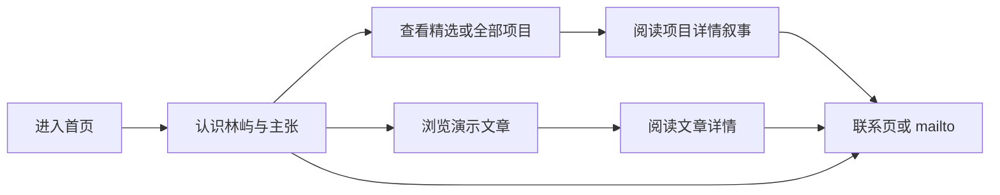

# 个人作品集网站大幅改版产品需求文档（PRD2）

- **文档版本**：v0.1（改版整体需求草案）
- **对应原文档**：[`PRD.md`](PRD.md) v1.0、[`TECH_DESIGN.md`](TECH_DESIGN.md) v1.0（本文件**不替代**二者，作为下一轮大幅改版的产品依据）
- **本期交付范围**：仅本需求文档；**不修改**代码、素材、原 `PRD.md` 或 `TECH_DESIGN.md`
- **技术约束**：沿用仓库当前 Next.js（App Router）+ TypeScript + Tailwind CSS + 文件化内容组织方式 + Cloudflare 部署目标；不在本轮引入新依赖或改动运行时

---

## 0. 演示内容与真实性声明（强制）

本改版采用**明确虚构角色**作为网站主人公，用于课程/作品集演示与视觉叙事，**不是**现有站点所有者的真实履历。

| 规则 | 说明 |
|------|------|
| 人物 | 林屿 / Lin Yu（虚构） |
| 经历、项目、文章、视频、量化成果 | 一律标注为**演示内容**或**概念案例** |
| 联系方式 | 使用演示占位（如 `hello@linyu.demo`）；不得使用真实私人邮箱、私人照片、真实 B 站账号与真实播放/粉丝统计 |
| 与现站关系 | 不得把虚构数据写成「苑阳」或任何真实人物的履历；现有私人素材仅可作为「待废弃」清单引用，不得列为正式可用素材 |

文中凡出现「林屿」「概念项目」「演示文章」等，均适用本声明。

---

## 1. 现状评估

评估基于：阅读 `AGENTS.md`、`PRD.md`、`TECH_DESIGN.md`、`package.json` 与 `app` / `components` / `lib` / `content` / `public`；本地 `next dev` 实际查看首页、关于、技能、项目、博客、联系；桌面约 **1440×900** 与手机约 **375×812** 视口检查。

### 1.1 现有实现的具体问题

#### 布局与响应式

- 首页 Hero 在桌面为双栏（文案左、肖像右），结构可读；但在 `max-width: 900px` 时 [`app/globals.css`](app/globals.css) 对 `.home-hero-visual` 使用 `order: -1`，**手机首屏先出现大幅肖像，角色名、价值主张与 CTA 被推到首屏之外**，与「30 秒认识我」目标冲突。
- 顶栏无汉堡菜单、无当前路由高亮：375 宽度下导航链接换行，Header 高度约 **130px+**，进一步挤压首屏可用内容区。
- 内容容器约 `min(1120px, 100% - 48px)`，各页大量「大 Hero 卡 + 稀疏正文」，首屏信息密度偏低，滚动后才进入实质模块。
- 项目列表仅一张大卡；无筛选栏、无空状态、无站内详情入口（按钮直链 GitHub）。
- 博客页主体是笔记本外框视频轮播，**不是文章列表**；与导航文案「博客」及原 PRD 的文章模型不一致。

#### 字体层级与排版

- 字体：`Plus Jakarta Sans` + 中文系统回退（`Noto Sans SC` / 苹方 / 微软雅黑）；全站偏同一无衬线，缺少展示级与正文级的分工，编辑感弱。
- H1 使用很大 `clamp`（首页约 2.5–5rem），姓名渐变着色；辅助 `eyebrow` 小号大写英文字母间距夸张，层级依赖「巨大标题 + 灰色段落」，中间层（H2/导语）节奏重复。
- 正文色 `--muted: #5b6b7c`，在浅底上可读但对比偏软；长段介绍在关于页/博客 Hero 中偏散文堆叠，缺少小标题与可扫读结构。

#### 背景与配色

- 背景：多层径向渐变（青/蓝/暖橙）+ ambient orb + 网格，整体「软科技玻璃」气质，**识别度一般**，与「鲜明视觉识别」有距离。
- 主色青绿 `--accent: #0f766e`，辅以天空蓝 eyebrow、局部深青绿面板；卡片半透明白边 + 大圆角 + 轻阴影，组件形态接近通用模板。
- 缺少统一的「浅暖纸感底 + 深墨字 + 克制点缀色 + 局部深色展区」编辑式分区语言。

#### 内容密度与图片质量

- 首页模块齐全但**单薄**：精选技能 3 卡、精选项目 1 个、视频 2 条；缺少精选文章。
- 肖像为生活场景竖图（海边/岩石），偏社交照片而非作品集角色视觉；项目封面为 GitHub 仓库截图，过程图与成果图缺失。
- 关于页混排肖像、机械臂本地视频、生活照，叙事主题（机器人学生）清晰，但与「作品集级视觉陈列」所需的大幅作品图、留白节奏不符。

#### 项目展示与博客结构

- `/projects`：仅「Only Me Notebook」一条；无类型/技术筛选；`/projects/[slug]` **直接 `notFound()`**。
- `/blog`：本地 mp4 轮播 + B 站统计卡（粉丝/获赞/播放）+ 外链 CTA；`/blog/[slug]` **直接 `notFound()`**。
- 技能页为分类标签卡 + 课程列表 + 荣誉深色面板；技能与项目关联弱（仅「查看相关项目」总链），易成标签墙。

#### 手机首屏（375）实测结论

1. 肖像在文案之上（`order: -1`）。
2. 导航占高过大。
3. CTA「查看项目 / 联系我」需滚动才进入稳定视口。
4. 375 宽度下首页 `scrollWidth === 375`（无明显横向溢出）；问题主要在**首屏优先级**而非溢出。

### 1.2 值得保留的功能与内容结构

| 保留项 | 原因 |
|--------|------|
| 路由骨架：`/`、`/about`、`/skills`、`/projects`、`/blog`、`/contact`、404、sitemap、robots | 信息架构完整，改版可替换内容与视觉，不必重造路由名 |
| 首页模块顺序：Hero → 关于摘要 → 技能 → 项目 → 内容区 → 联系 CTA | 符合「认识 → 证明 → 联系」路径，改版保留顺序并强化各段质量 |
| 独立联系页 + 表单 API（限流、Zod、发信） | 超出原一期 mailto 设想，但可用；改版改为演示渠道并加「演示站点」说明 |
| 本地视频「封面/首帧 + 点击后播放、不自动发声」 | 符合无障碍与性能原则；降级为项目/过程辅助，不占据博客主体 |
| `Reveal` + `prefers-reduced-motion`、可见 `:focus-visible`、语义化 `header/nav/main/section` | 质量底线可延续并加强 |
| `lib/constants` + 精选数据抽离的方向 | 需演进为统一内容源；分层意图可保留 |

### 1.3 明确区分：现有实现 vs 原 PRD 尚未实现的设想

#### A. 现有实现已有（即使与文档描述不完全一致）

- 多页面静态展示站 + 全局 Header/Footer
- 首页精选技能/项目/视频区块、关于散文叙事、技能分类与荣誉、项目列表单卡、联系表单 API
- 青绿浅色主题与手写 CSS 组件（Tailwind 已引入但页面样式以 `globals.css` 手写类为主）
- sitemap / robots（默认站点 URL 仍可能是占位域名）

#### B. 原 PRD / TECH_DESIGN 已写、现有实现未落地

| 设想 | 现状 |
|------|------|
| MDX + `lib/content` Zod 校验 + `lib/services` 供数 | `content/` 空目录；`gray-matter` / `next-mdx-remote` 已装未用；内容硬编码在页面与 `featured.ts` |
| 项目详情、博客文章详情、目录、上下篇 | slug 路由恒 404 |
| 项目/博客 URL 筛选、空状态、清除筛选 | 无 |
| 导航当前态、移动端折叠菜单与焦点管理 | 无 |
| B 站 iframe 延迟加载与失败回退播放器 | 仅外链 + 本地视频 |
| 经历时间线、教育结构化、简历下载 | 关于页散文；`public/resume` 空 |
| 完整 metadata / OG / canonical 每页 | 弱（layout 级默认为主） |
| Vitest / Playwright / Prisma+MySQL 二期 | 目录或文档有、工程未接 |

#### C. 文档内部与「文档 vs 实现」不一致（实施时需注意，本轮只记录）

- `TECH_DESIGN.md` 开篇架构图写过 PostgreSQL，后文与 `AGENTS.md` 确定为 **MySQL + Prisma**。
- TECH_DESIGN 建议 Radix、Motion、独立 `tailwind.config`、完整测试脚本等，当前 `package.json` 未包含对应依赖与 test 脚本。
- 原 PRD 一期强调 mailto 为主；实现已有联系表单后端——改版应在 PRD2 中定义为**可选演示能力**，并标明隐私与反垃圾要求。
- `AGENTS.md` 要求真实性优先、不编造履历；本改版通过**虚构角色 + 演示声明**满足课程演示需求，同时避免冒充真实人物。

### 1.4 改版要解决的核心矛盾（一句话）

把「真实学生身份的青绿软玻璃展示页 + 视频冒充博客 + 空壳详情路由」升级为「虚构创意前端人设的明亮编辑式作品集 + 可阅读的项目/文章叙事 + 手机首屏先传达主张」。

---

## 2. 产品定位与用户路径

### 2.1 虚构角色设定（演示）

| 字段 | 内容 |
|------|------|
| 中文名 / 英文名 | 林屿 / Lin Yu |
| 角色 | 创意前端工程师 × 数字体验设计师 |
| 一句话主张 | 把复杂产品讲清楚，把交互做成可感知的体验。 |
| 工作方式（演示文案） | 从问题与用户任务出发，用排版、动效预算与工程化组件把体验落地到可维护的前端。 |
| 公开地点（演示） | 上海 · 可远程 |
| 公开邮箱（演示） | `hello@linyu.demo`（占位，不发送真实私信至私人邮箱） |
| 社交（演示） | GitHub / 设计作品集外链使用占位 URL；**不**绑定真实 B 站账号与统计 |

### 2.2 目标访客

| 访客 | 关注点 | 成功行为 |
|------|--------|----------|
| 招聘者 / 面试官 | 作品深度、前端工程与体验判断力、沟通成本 | 2 次点击内到达项目详情或联系 |
| 潜在客户 / 合作方 | 是否做过类似站点或产品体验、交付边界 | 按标签找到相关概念案例并发起联系 |
| 技术同行 / 内容读者 | 方法论文章、可复用思路 | 读完一篇文章并浏览相关项目 |
| 普通访客 | 快速留下印象 | 记住姓名与主张，或收藏作品 |

### 2.3 核心价值主张

1. **叙事清晰**：首屏即「我是谁、做什么、下一步去哪」。
2. **用作品证明**：技能由 3 个差异化概念案例支撑，拒绝标签墙。
3. **编辑式阅读体验**：大幅作品图、有节奏留白、可读正文。
4. **低成本联系**：演示邮箱 / 表单 / 社交占位，路径短、文案明确。

### 2.4 主要用户路径



**路径细则**

1. **认识**：首页 Hero（姓名、角色、主张、双 CTA）→ 关于摘要或 `/about`。
2. **证明**：CTA「查看作品」→ `/projects` → `/projects/[slug]`；技能页条目链到关联项目。
3. **深化**：首页精选文章或 `/blog` → `/blog/[slug]`；文内链到相关项目。
4. **联系**：全站页脚 + 首页深色 CTA + `/contact`；主按钮文案「发邮件」/「填写演示表单」。

---

## 3. 视觉方向与设计系统

**方向名称**：明亮的编辑式作品集（Bright Editorial Portfolio）

原则：浅暖纸感背景、深色文字、克制蓝紫点缀、局部深色展示区、大幅作品图、有节奏留白。借鉴参考站的分区节奏与项目陈列，但使用本项目独立的网格、字体与色彩，避免模板感图标墙。

### 3.1 色彩变量（建议 CSS 令牌）

| Token | 建议值 | 用途 |
|-------|--------|------|
| `--bg` | `#FBFAF7` | 页面主背景 |
| `--bg-warm` | `#F7F3EC` | 交替分区浅暖底 |
| `--fg` | `#1A1A1F` | 主标题与正文 |
| `--fg-muted` | `#5C5A66` | 辅助说明（须仍满足 AA：与底对比 ≥ 4.5:1） |
| `--line` | `#E6E1D8` | 分割线、输入框边 |
| `--surface` | `#FFFFFF` | 可交互卡片表面 |
| `--accent` | `#4F46E5` | 链接、选中、主按钮（克制蓝紫） |
| `--accent-soft` | `#EEF0FF` | 标签底、淡选中 |
| `--accent-hover` | `#4338CA` | 主按钮 hover |
| `--ink-panel` | `#16161D` | 局部深色展区背景 |
| `--ink-panel-fg` | `#F5F5F7` | 深色区正文 |
| `--ink-panel-muted` | `#A8A7B3` | 深色区辅助 |
| `--focus` | `#6366F1` | 焦点环 |
| `--danger` | `#B42318` | 表单错误 |

**禁止**：大面积紫粉渐变、多色 orb 堆叠作为主识别；颜色不得作为状态唯一通道。

### 3.2 字体

| 角色 | 首选 | 回退 |
|------|------|------|
| 中文正文 / UI | `Noto Sans SC` 或 `Source Han Sans SC` | `"PingFang SC", "Microsoft YaHei", sans-serif` |
| 英文展示标题 | `Fraunces` 或 `Newsreader`（择一锁定） | `Georgia, "Times New Roman", serif` |
| 中英文 UI / 正文混排 | `Geist` 或 `Inter`（择一锁定） | `ui-sans-serif, system-ui, sans-serif` |
| 代码 | `ui-monospace` | `"SF Mono", Consolas, monospace` |

加载策略：展示字体仅用于 H1/品牌名；正文优先系统或子集化 Web 字体；**不得**因字体阻塞首屏文案。

### 3.3 字号层级（桌面基准，移动端按比例下调一档）

| 层级 | 尺寸 | 字重 | 行高 | 用途 |
|------|------|------|------|------|
| Display | 48–64px | 600–700 | 1.1 | 首页姓名/主张 |
| H1 | 36–44px | 650 | 1.15 | 页面标题 |
| H2 | 28–32px | 650 | 1.25 | 区块标题 |
| H3 | 20–22px | 600 | 1.35 | 卡片/案例标题 |
| Body | 16–18px | 400 | 1.7 | 正文 |
| Small | 13–14px | 500 | 1.5 | 元信息、标签 |
| Overline | 12px | 600 | 1.4 | 分区眉题（可中英混排，不必全大写英文） |

- 正文行长：**65–72ch**（文章详情）；列表页说明可放宽到约 60ch。
- 字距：展示标题轻微负字距（约 -0.02em）；正文默认。

### 3.4 间距、网格与容器

- 间距尺度：`4 / 8 / 12 / 16 / 24 / 32 / 48 / 64 / 96`（px）
- 内容最大宽：`1200px`；阅读列：`720px`
- 页边：移动 `20px`，平板 `32px`，桌面 `48px`
- 网格：桌面 12 列，沟槽 24px；项目大图允许打破容器全宽出血
- 区块垂直节奏：浅色区与浅暖区交替，或插入一段深色展区，避免每屏同质卡片

### 3.5 按钮、卡片、图标

**按钮**

| 类型 | 样式 |
|------|------|
| Primary | 实心 `--accent`，白字，高 48px，圆角 8px |
| Secondary | 白底 + `--line` 边，深字 |
| Ghost | 无底，下划线或文字链样式，用于「查看全部」 |

**卡片**：默认无卡。仅项目列表项、文章列表项、联系渠道等**可点击单元**使用浅边或极轻表面；Hero 禁止卡片化堆叠。

**图标**：线性 1.5–2px，默认 24×24；触控热区 ≥ 44×44；不依赖彩色技能图标墙。

### 3.6 背景图形

- 主识别：浅暖底 + 少量抽象曲线（SVG，低对比，装饰 `aria-hidden`）
- 分区：直角色块切换，而非多层彩色光斑
- 深色展区：用于「精选作品横滑/大图」或联系 CTA，增强节奏
- 废弃现站 ambient 三 orb 作为主背景语言

### 3.7 动效原则

| 允许 | 禁止 |
|------|------|
| 区块进入：opacity + 8–12px 上移，≤ 400ms | 首屏文案/CTA 等待动画才显示 |
| 链接/按钮：颜色与边线过渡 ≤ 200ms | 大幅缩放导致布局跳动 |
| 项目列表：hover 边线或 2px 平移（桌面） | 闪烁、视差眩晕、自动播放带声视频 |
| `prefers-reduced-motion: reduce` 时关闭进入动画与装饰漂移 | 动效作为唯一信息通道 |

---

## 4. 信息架构与逐页需求

```text
/                 首页
/about            关于林屿（演示）
/skills           技能（由案例支撑）
/projects         项目列表
/projects/[slug]  项目详情
/blog             文章列表
/blog/[slug]      文章详情
/contact          联系
404               未找到
```

全站公共：品牌名「林屿」、导航（首页/关于/技能/项目/博客/联系）、页脚（版权「演示作品集」、演示邮箱、社交占位、返回顶部）。桌面显示当前路由；**≤768px 使用折叠菜单**（Esc 关闭、焦点返回按钮）。

### 4.1 首页 `/`

**目标**：5 秒内识别林屿与主张；引导至作品或联系。

**模块顺序**

1. **Hero**
   - 眉题：`创意前端 · 数字体验`
   - 主标题：`林屿`（品牌级）
   - 副标题：`把复杂产品讲清楚，把交互做成可感知的体验。`
   - 短述：`演示作品集：界面工程、编辑式排版与有预算的动效。`
   - CTA：主「查看作品」→ `/projects`；次「联系我」→ `/contact`
   - **桌面**：文案左 / 角色视觉右（或文案上、全宽作品静帧下）
   - **移动端（强制）**：先文案与双 CTA，再大幅视觉；**禁止**将视觉 `order` 提前到文案之前
2. **信任条（可选一行）**：`概念案例 × 3 · 方法论文章 × 3 · 可联系演示邮箱`（不写虚假雇佣公司）
3. **关于摘要**：3–4 句 +「完整介绍」
4. **精选技能**：4 项，每项一句话 + 关联项目锚点（非标签云）
5. **精选项目**：2–3 个大图条目（封面、名称、一句话问题、角色、进入详情）
6. **精选文章**：2–3 篇（标题、摘要、日期、阅读时长）
7. **过程片（可选，P1/P2）**：最多 1 条，封面 + 点击播放；无则整区隐藏
8. **深色联系 CTA**：`有产品体验或站点需要一起打磨？` + 按钮

**主要文案（可直接用于内容文件）**

- Hero 短述见上。
- 关于摘要：`我关注把设计意图稳定地落到前端：信息层级、响应式节奏、可访问交互与可维护组件。以下案例与文章均为课程演示用的概念内容。`

**交互**：卡片整卡可点进详情；外链单独命名。首屏图像可 `priority`，其余懒加载。

**移动端**：单列；Hero 文案优先；导航折叠；触控目标 ≥ 44px。

### 4.2 关于 `/about`

**目标**：建立可信的人物叙事（演示），说明工作方式与关注点。

**模块顺序**

1. 标题：`关于林屿`
2. 导语 + 角色视觉（非私人生活照风格；用角色插画或匿名工作室场景图）
3. **我做什么**：三条能力叙事（体验落地 / 编辑式前端 / 动效与可达性）
4. **经历时间线（演示）**：2–3 段虚构经历，每段标明「演示经历」
5. **教育（演示）**：一条占位学历，标明演示
6. **当前关注**：设计系统落地、内容型站点性能、减少动效偏好下的反馈设计
7. 次 CTA：查看作品 / 阅读文章

**移动端**：单列；时间线改为纵向轴。

### 4.3 技能 `/skills`

**目标**：用「能力 → 场景 → 关联项目」证明，而不是堆栈名。

**模块顺序**

1. 页头：`技能与方法` / `每项能力都能在概念案例里找到对应决策。`
2. 分组（建议 4 组）：
   - 界面工程（React/Next、语义化 HTML、CSS 架构）
   - 体验与排版（信息层级、编辑式版式、响应式）
   - 动效与可达性（动效预算、焦点、reduced-motion）
   - 协作与质量（设计交接、内容模型、基础性能）
3. 每项：名称、2–3 句场景、`关联项目` 链接（slug）
4. 底部：链到 `/projects`

**禁止**：百分比进度条炫技；无关联项目的孤立标签列表作为主内容。

### 4.4 项目列表 `/projects`

**目标**：可扫读、可筛选、可进入详情。

**模块顺序**

1. 页头：`作品` / `三个彼此不同的概念案例，覆盖媒体站、B2B 控制台与电商结账。`
2. 筛选：类型（Editorial / Product / Interaction）与技术标签；状态写入 URL（如 `?type=editorial&tag=nextjs`）
3. 列表：大图优先（桌面可左右图文交替；移动单列图上线下）
4. 空状态：`没有符合条件的项目` + 「清除筛选」
5. 页脚提示：`全部案例为演示内容，成果数据为概念示意。`

**交互**：筛选可键盘操作；清除后恢复全部；浏览器后退保持 query。

### 4.5 项目详情 `/projects/[slug]`

**目标**：完整案例叙事。

**模块顺序**

1. 标题、角色、周期、标签、封面
2. 问题与背景
3. 目标与职责
4. 过程（研究/结构/实现要点，配过程图）
5. 结果展示（界面大图或深色展区画廊；概念指标须标注「示意」）
6. 技术栈与外部链接（Demo/Repo 可为占位或隐藏）
7. 相关项目、返回列表、上一案/下一案

**异常**：无封面用统一占位；无外链则隐藏按钮。

### 4.6 博客列表 `/blog`

**目标**：**文章**是主体；视频不是博客。

**模块顺序**

1. 页头：`笔记与方法`
2. 可选分类筛选（Engineering / Design / Accessibility）
3. 文章列表：封面、标题、摘要、日期、阅读时长、分类
4. 可选：「过程片」次级入口链到项目详情中的视频块（非整页主体）

### 4.7 文章详情 `/blog/[slug]`

**模块顺序**：标题与元信息 → 可选封面 → 正文（清晰 H2/H3）→ 长文目录（≥1500 字启用）→ 相关项目/文章 → 返回列表。

**要求**：代码块容器内横向滚动；页面整体不横向溢出；图片有 alt。

### 4.8 联系 `/contact`

**目标**：低摩擦建立联系，并标明演示站点。

**模块顺序**

1. 标题：`联系`
2. 说明：`本站为课程演示作品集。以下为演示联系渠道；请勿提交真实敏感信息。`
3. 主渠道：`mailto:hello@linyu.demo` + 可选「复制邮箱」
4. 演示表单：姓名、邮箱、主题、留言（可复用现有 API 思路；成功/失败需文本反馈）
5. 其他：GitHub / 作品集占位外链

### 4.9 404

文案：`页面不存在或已移动。`  
入口：回首页、作品、博客。

---

## 5. 内容方案（演示 / 概念）

### 5.1 概念项目（至少 3 个，彼此有区别）

#### 项目 A：Tidepress Editorial（媒体编辑站）

| 项 | 内容 |
|----|------|
| slug | `tidepress-editorial` |
| 类型 | Editorial |
| 问题 | 文化媒体站信息嘈杂，手机端标题层级崩溃，长文难读 |
| 角色 | 前端实现 + 版式落地（演示） |
| 过程 | 内容模型（栏目/文章）→ 字号与网格规范 → 响应式文章模板 → 列表性能（图片尺寸） |
| 结果展示 | 首页大图杂志感、文章页阅读列、手机端标题栈截图 |
| 所需图 | 封面 16:10；桌面首页 16:9；文章页 3:4；手机 9:16 一帧 |
| 支撑技能 | 编辑式排版、响应式、内容型前端 |

#### 项目 B：Atlas Lab Console（B2B 控制台）

| 项 | 内容 |
|----|------|
| slug | `atlas-lab-console` |
| 类型 | Product |
| 问题 | 数据产品侧栏过深、空状态缺失、关键指标对比不足 |
| 角色 | 体验重构 + 界面工程（演示） |
| 过程 | 任务流拆解 → 信息架构减层 → 表格/过滤模式 → 深色监控展区 |
| 结果展示 | 改造前后对照（示意）、空状态、深色仪表盘大图 |
| 所需图 | 封面 16:10；控制台全宽 16:9；空状态 4:3；细节 1:1×2 |
| 支撑技能 | 信息层级、组件化、深色界面 |

#### 项目 C：Kinetic Checkout（结账微交互）

| 项 | 内容 |
|----|------|
| slug | `kinetic-checkout` |
| 类型 | Interaction |
| 问题 | 结账步骤反馈弱、错误提示靠颜色、动效干扰速度 |
| 角色 | 交互原型 + 前端实现（演示） |
| 过程 | 动效预算表 → 焦点顺序 → 错误文案与图标双通道 → reduced-motion 降级 |
| 结果展示 | 步骤流 GIF/短视频（点击播放）、焦点态静帧、降级对照 |
| 所需图 | 封面 16:10；三步静帧 4:3；焦点态标注图 |
| 支撑技能 | 动效预算、无障碍、表单体验 |

### 5.2 演示文章（至少 3 篇）

| slug | 标题 | 摘要提纲 | 关联项目 |
|------|------|----------|----------|
| `editorial-type-on-the-web` | 把杂志感排版落到 Web | 字号阶梯、行长、网格与组件化标题；如何避免「只在桌面好看」 | tidepress-editorial |
| `skills-need-case-studies` | 技能页不要做成标签墙 | 用「场景 + 决策 + 链接到案例」组织技能；招聘者如何扫读 | atlas-lab-console |
| `motion-with-reduced-motion` | 有预算的动效与减少动态效果 | 何时用过渡、如何双通道反馈、prefers-reduced-motion 清单 | kinetic-checkout |

每篇建议结构：问题 → 原则 → 示例（可引用概念项目截图）→ 可执行清单 → 延伸阅读。

### 5.3 可选视频（辅助，不占博客主体）

| id | 用途 | 规格 | 行为 |
|----|------|------|------|
| `kinetic-checkout-walkthrough` | 结账流程演示 | 16:9，封面必填 | 不自动播放、不自动发声；点击加载；失败显示「在新标签打开」外链 |
| `tidepress-responsive-pass` | 响应式巡检录屏（可选） | 16:9 | 同上；无片源则隐藏模块 |

视频可出现在：对应**项目详情**或首页「过程片」；**不得**替换 `/blog` 文章列表。

---

## 6. 素材方案

### 6.1 资产清单

| 资产 | 用途 | 画幅 | 建议导出 | alt 示例 | 加载 |
|------|------|------|----------|----------|------|
| 角色视觉 | Hero / 关于 | 4:5 或 1:1 | 1200×1500 或 1200×1200 | `林屿的角色形象（演示）` | 首页 priority |
| 项目封面 ×3 | 列表/分享 | 16:10 | 1600×1000 | `{项目名} 概念案例封面` | 列表 lazy；精选可 eager |
| 过程图 ×6–9 | 详情叙事 | 4:3 | 1600×1200 | 描述具体界面状态 | lazy |
| 文章配图 ×3 | 列表/文首 | 3:2 | 1500×1000 | 与标题相关的示意 | lazy |
| 背景曲线 SVG | 分区装饰 | 自适应 | 矢量 | 空 alt（装饰） | 内联或 CSS |
| 视频封面 ×1–2 | 过程片 | 16:9 | 1600×900 | `{标题} 视频封面` | lazy；点击前不加载播放器 |
| OG 默认图 | 分享 | 1.91:1 | 1200×630 | 站点名 + 主张短句 | 构建时 |

**失败策略**：`onError` 换统一占位（浅暖底 + 项目名文本），不显示破损图标。

### 6.2 必须废弃的现有私人/真实素材（不得列入正式可用）

- `public/images/个人01.jpg`、`life.jpg`、`生活01.jpg` 等真人私人照片
- 真实邮箱默认值、真实 B 站 handle/space、真实粉丝与播放统计
- 以真实人物名义撰写的学校、籍贯、奖学金与竞赛表述（改版中替换为林屿演示文案）

### 6.3 合法外采素材登记表（实施前填写；未确认许可不得标「可用」）

| 文件名 | 用途 | 来源 URL | 许可 | 署名要求 | 状态 |
|--------|------|----------|------|----------|------|
| （待填） | 角色视觉 | | CC0 / Unsplash / 自绘 等 | | 未确认 |
| （待填） | tidepress 封面 | | | | 未确认 |
| （待填） | atlas 封面 | | | | 未确认 |
| （待填） | kinetic 封面 | | | | 未确认 |

规则：无法确认许可的素材**不得**写入「正式可用」；可先用纯色几何占位完成 P0 布局。

### 6.4 外部视频约束

- 不自动播放、不自动发声
- 必须有封面与标题文本
- 必须有外链回退
- iframe 权限最小化；优先点击后再挂载播放器
- 不阻塞首屏 LCP 文案

---

## 7. 交互与质量标准

### 7.1 导航

- 桌面：当前页用颜色或下划线标识（非仅靠颜色）
- 移动：按钮打开菜单；`Esc` 关闭；关闭后焦点回按钮；打开时焦点落入菜单
- 品牌点击回首页

### 7.2 项目筛选与空状态

- 条件反映在 URL；可分享、可后退
- 无结果：明确文案 + 「清除筛选」
- 筛选控件可键盘到达与操作

### 7.3 文章阅读

- 标题层级不跳级；目录锚点可用键盘
- 代码块内部可横向滚动；`body` 无横向滚动条
- 草稿不出现在列表与 sitemap（内容管线就绪后）

### 7.4 联系入口

- 全站至少两处：页脚 + 首页 CTA 或联系页
- 复制邮箱需文本成功/失败反馈
- 表单错误逐字段说明

### 7.5 无障碍与动效

- 可见焦点环（`--focus`）
- 图片有意义 alt；装饰空 alt
- `prefers-reduced-motion: reduce` 关闭非必要动画
- 核心文案与 CTA **不依赖**动画或第三方脚本出现

### 7.6 图片加载失败

- 占位表面 + 项目/文章标题文本
- 不导致布局塌陷（固定宽高比盒子）

### 7.7 验收视口与质量门槛

| 项 | 标准 |
|----|------|
| 视口 | **375 / 768 / 1024 / 1440** px 人工检查 |
| 溢出 | 无页面级横向滚动 |
| 首屏（375） | 可见：姓名、主张、至少一个主 CTA；视觉在其后 |
| 对比度 | 普通文字与背景满足 **WCAG AA**（≥ 4.5:1） |
| 性能体验 | 首屏关键内容不被视频/字体/动画阻塞 |
| SEO 基础 | 每页唯一 title/description；详情可设 canonical（P1） |

---

## 8. 实施边界与优先级

### 8.1 技术与范围边界

**沿用**

- Next.js App Router、TypeScript、Tailwind、现有包管理与 Cloudflare 部署约束
- 公开只读作品集；不新增登录、CMS、评论、复杂搜索、统计面板

**本轮文档之后的实施建议（仍不在本次改文件）**

1. 先换设计令牌与布局（含手机 Hero 顺序、MobileNav），再替换人设文案。
2. 补齐项目/文章详情数据；逐步把硬编码迁回 `content/` + `lib/content` 校验（与 TECH_DESIGN 对齐）。
3. 联系表单可保留，但文案与收件配置改为演示渠道；移除真实私人默认值。
4. 文档冲突（MySQL vs 文中偶发 PostgreSQL、未落地测试栈）在实施 TECH 同步时修正，避免静默分叉。

**明确不做（相对本改版 P0–P2）**

- 把虚构履历写成真实人物故事
- 继续用 `/blog` 承载 B 站统计作为主体
- 为视觉改版强行引入大型动画库（优先 CSS）

### 8.2 优先级

#### P0（必须，第一阶段可上线演示）

- 设计令牌（色、字体、间距）落地到全局样式
- Header：当前态 + 移动折叠菜单
- 首页 Hero 移动端文案优先；虚构林屿全站文案替换
- 3 个概念项目列表 + 可访问详情页
- 3 篇演示文章列表 + 详情页
- 技能页改为「叙事 + 关联项目」
- 联系页演示声明 + 占位邮箱
- 404、页脚、去掉真实私人照与 B 站统计主体
- 验收：375/1440 首屏与无横向溢出、AA 对比度抽查

**P0 验收标准摘要**

- [ ] 全站不再出现原私人身份联系方式与私人照片
- [ ] 手机首屏先见角色与 CTA
- [ ] `/projects/[slug]`、`/blog/[slug]` 对 3+3 内容可打开
- [ ] 博客为文章列表而非视频主页

#### P1（体验完整）

- 项目 URL 筛选 + 空状态
- 文章分类与长文 TOC
- 正式合法素材置换与 OG 图
- 深色展区项目陈列、分区曲线背景
- 动效与 reduced-motion 精修
- 每页 metadata / canonical

#### P2（结构对齐与增强）

- MDX 内容管线与 Zod 校验全面替换硬编码
- 可选过程视频模块
- RSS、相关推荐、简历 PDF 占位
- 测试（组件/E2E）与 Cloudflare 适配核对
- 二期数据库仍按 TECH_DESIGN，不为本静态演示提前耦合

### 8.3 建议落地顺序

```text
阶段 1（P0）  设计令牌 + 布局导航 + 人设替换 + 项目/文章详情骨架
阶段 2（P1）  筛选/TOC/素材/深色展区/SEO
阶段 3（P2）  MDX 管线对齐文档 + 可选视频 + 质量工具链
```

---

## 9. 参考站借鉴清单

### 9.1 [emmabostian/developer-portfolios](https://github.com/emmabostian/developer-portfolios)

| 可借鉴 | 如何改造应用到本项目 | 需避免 |
|--------|----------------------|--------|
| 大量真实作品集的信息架构多样性（Hero 主张、项目优先、关于后置等） | 固定本站路径为「主张 → 作品详情 → 文章方法 → 联系」；用清单做对照检查而非逐站抄布局 | 把仓库当模板库直接套皮肤；堆砌外链墙而无自己的案例叙事 |
| 「用项目证明能力」的共识 | 技能页强制关联 3 个概念项目 slug | 复制他人真实项目截图冒充作品 |

### 9.2 [vi5hal.vercel.app](https://vi5hal.vercel.app/#skills)

| 可借鉴 | 如何改造应用到本项目 | 需避免 |
|--------|----------------------|--------|
| 单页分区节奏清晰（介绍 → 作品 → 技能 → 经历） | 映射为多路由但仍保持同样的叙事节奏；首页保留精选，详情下沉到子页 | 单页锚点站取代本项目已有多路由 IA |
| 技能区集中展示 | 改为「能力短叙 + 链到案例」，服务编辑式作品集 | emoji、彩色技术图标墙、过密时间线与口号式堆叠 |
| 项目卡片含 Live/Github | 详情页提供可选外链；列表以问题陈述与大图为主 | 只有双按钮无过程叙事的卡片作为唯一项目形态 |

### 9.3 [yujisatojr/react-portfolio-template](https://yujisatojr.github.io/react-portfolio-template/)

| 可借鉴 | 如何改造应用到本项目 | 需避免 |
|--------|----------------------|--------|
| 项目条目信息密度（标题 + 一句话 + 技术要点） | 列表用大图 + 一句话问题 + 角色；技术要点放详情 | 多列小图网格导致编辑感丧失 |
| 经历时间线结构 | `/about` 采用纵向时间线，条目标注「演示经历」 | 模板默认头像/配色/技能图标栅格原样搬迁 |
| 能力分块（前端/DevOps/AI 等） | 改为与林屿定位一致的四组方法，删除无关技术栈堆砌 | 深色默认主题与泛用模板视觉；本项目坚持浅暖编辑式 |

---

## 10. 文档维护

- 下一轮开发应以本 `PRD2.md` 拆分页面任务与验收清单。
- 若实施中变更人设、令牌或内容字段，应更新本文件或另起 `PRD2` 修订版本，并同步 `TECH_DESIGN` 中与实现冲突的段落。
- 原 [`PRD.md`](PRD.md) 仍保留为历史一期需求；冲突时以**已确认的 PRD2 改版范围**为准（仅限改版工作流），但不得在未同步的情况下静默改代码偏离两者。

---

*完。本文仅为需求草案，不包含代码或素材变更。*
